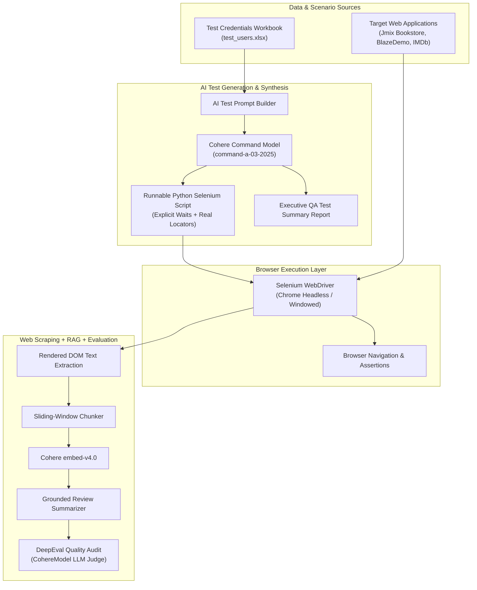

# AI-Powered Selenium TestOps

[](https://www.python.org/downloads/)
[](https://www.selenium.dev/)
[](https://cohere.com/)
[](https://confident-ai.com/)
[](https://openpyxl.readthedocs.io/)
[](https://opensource.org/licenses/MIT)

An advanced **AI TestOps & Automated Web QA Laboratory** integrating **Selenium WebDriver**, **Cohere ClientV2**, **OpenPyXL**, and **DeepEval**.

This repository demonstrates how to combine traditional browser automation with Generative AI: dynamic synthesis of Selenium test scripts from live Excel credentials, automated execution and verification, web scraping with multilingual translation, and end-to-end vector RAG quality audits over rendered dynamic web pages.

---

## Architecture Flow



---

## Pattern Catalog

| Script | Pattern | Tech Stack | Highlights |
|---|---|---|---|
| [`01_selenium_script_generator.py`](examples/01_selenium_script_generator.py) | **AI Test Script Generation** | Cohere Command-A, Python | Prompts Cohere to write complete, executable Selenium scripts from a URL and generates executive summary reports. |
| [`02_datadriven_script_synthesis.py`](examples/02_datadriven_script_synthesis.py) | **Data-Driven Prompt Synthesis** | OpenPyXL, Cohere, Python | Reads Excel accounts at random and synthesizes secure, parameterized Selenium scripts reading environment variables. |
| [`03_live_selenium_login_runner.py`](examples/03_live_selenium_login_runner.py) | **Live Automated Browser Runner** | Selenium WebDriver, Chrome | Runs live end-to-end authentication against Jmix Bookstore with explicit `WebDriverWait` and URL assertions. |
| [`04_selenium_scraping_translation.py`](examples/04_selenium_scraping_translation.py) | **Scraping + Translation** | Selenium Headless, Cohere Translate | Scrapes destination text from BlazeDemo Vacation and translates it into Hindi using Cohere translation models. |
| [`05_selenium_scraping_rag_evaluation.py`](examples/05_selenium_scraping_rag_evaluation.py) | **Scraping + Vector RAG + DeepEval** | Selenium, Cohere Embed, DeepEval | End-to-end TestOps: scrapes rendered IMDb reviews, builds dense vector index, generates summary, and asserts quality. |

---

## Project Structure

```text
LLM-ai-selenium-testops/
├── .env.example                               # Environment template
├── .gitignore                                 # Git ignore patterns
├── LICENSE                                    # MIT License
├── README.md                                  # Repository documentation
├── requirements.txt                           # Production dependencies
├── data/                                      # Sample test data
│   └── test_users.xlsx                        # Credentials workbook for bookstore login
├── src/
│   ├── __init__.py
│   └── cohere_evalmodel.py                    # Custom DeepEvalBaseLLM judge
└── examples/
    ├── 01_selenium_script_generator.py        # Dynamic AI test script & summary generation
    ├── 02_datadriven_script_synthesis.py      # Excel-driven prompt synthesis
    ├── 03_live_selenium_login_runner.py       # Live automated browser login runner
    ├── 04_selenium_scraping_translation.py    # Headless scraping + Hindi translation
    └── 05_selenium_scraping_rag_evaluation.py # Scraping + Vector RAG + DeepEval evaluation
```

---

## Getting Started

### 1. Prerequisites
- Python 3.10+
- Google Chrome browser installed
- A Cohere API key ([Cohere Dashboard](https://dashboard.cohere.com/api-keys))

### 2. Installation

```bash
# Clone the repository
git clone https://github.com/<your-username>/LLM-ai-selenium-testops.git
cd LLM-ai-selenium-testops

# Create and activate virtual environment
python -m venv .venv

# Windows:
.venv\Scripts\activate
# Linux/macOS:
source .venv/bin/activate

# Install dependencies
pip install -r requirements.txt
```

### 3. Environment Configuration

```bash
cp .env.example .env
```

Add your Cohere API key in `.env`:
```env
COHERE_API_KEY=your_actual_cohere_api_key_here

# Set HEADLESS=0 to view the browser window during test execution
HEADLESS=1
SELENIUM_WAIT_SECONDS=15
```

---

## Running the Examples

### 1. Generate an Automated Selenium Script with AI
```bash
python examples/01_selenium_script_generator.py
```
> Cohere dynamically synthesizes an executable Selenium script targeting real locators, followed by a formal QA summary report.

### 2. Data-Driven Script Synthesis
```bash
python examples/02_datadriven_script_synthesis.py
```
> Reads `data/test_users.xlsx`, samples an account at random, and generates a script adhering to credential security standards.

### 3. Run Live Selenium Browser Login
```bash
python examples/03_live_selenium_login_runner.py
```
> Launches Chrome, loads Jmix Bookstore, enters credentials, submits the form, and verifies the redirect.

### 4. Headless Scraping & Multilingual Translation
```bash
python examples/04_selenium_scraping_translation.py
```
> Extracts dynamic content from BlazeDemo Vacation in headless mode and translates destination names into Hindi.

### 5. Full Scraping + Vector RAG + DeepEval Quality Audit
```bash
python examples/05_selenium_scraping_rag_evaluation.py
```
> Scrapes live IMDb review DOM text, indexes text into dense vectors with `embed-v4.0`, generates a grounded summary, and executes automated DeepEval assertions with `CohereModel`.

---

## License
Distributed under the [MIT License](LICENSE).
